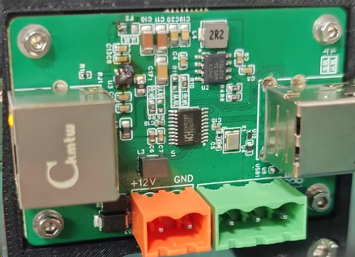
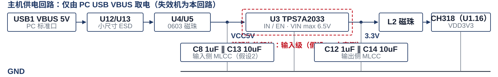
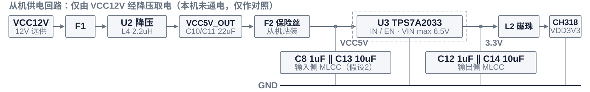

# PinProbe A1 TPS7A2033 输入侧失效初步分析报告

> 文档更新时间：2026-10-10 ｜ 版本 V1.0（初步推断，原因排序已按最新现场判断调整）｜ 依据：现场失效照片 + 供电支路网表（IO-PPA-CH318TUSBEXT-4F4-HASL V1.0）+ 现场反馈（失效机为主机、主/从机贴装正确、出厂前工作正常、损伤集中在 VIN 一侧）。**尚未取得失效实物，未做任何电测、拆解与 FA**；除机型、贴装与网表连接外，其余结论均为初步推断，须以第 4 章实测数据确认或推翻。

## 一、初步判断（待实测确认）

:::chips
失效器件 | U3 TPS7A2033（VIN max 6.5V）
推断部位 | 输入侧 VIN 附近（待验）
失效链条 | 输入级击穿 → VIN 短路 → 被 5V 灌流自烧（推断）
整机变体 | 主机 · 仅 VBUS 供电（已确认）
:::

:::note
**初步结论（未经验证）：** 失效机为**主机**且主/从机贴装正确（12V 支路与 VCC5V 物理断开），整机出厂前工作正常，5V 仅来自 PC USB VBUS。结合"损伤集中在 VIN 一侧、输出负载很轻"，当前更倾向于 **U3 输入级先被瞬态击穿、随后形成输入短路并被 PC VBUS 持续灌流而自烧**，而不是"CH318 后端短路把 U3 拖坏"。以上均为推断，**尚未经任何实物测量证实**。
:::

:::todo
**取得实物后先做：** ① 拆 U3 前后测 `VCC5V → GND`（区分"芯片内短路"与"板级电容短路"）② 核对现场插拔波形与 U12/U13 状态 ③ 核对线缆 pinout 与同口其它设备。第 ① 步即可把两条主假设分开。
:::

### 1.1 原因排序（工程先验估计，均未验证）

| 排序与候选根因 | 概率 | 支持证据 / 证据缺口 |
| --- | --- | --- |
| ① **ESD / 瞬态浪涌击穿 U3 输入级**，随后形成 VIN 短路并自烧 [[red:假设1]] | **40%** | 出厂正常 → 运输 → 到场首次插上即坏；**损伤集中在 VIN 一侧**；输入端无过压保护、取电路径无 TVS/保险丝 / !!未测现场插拔波形；U12/U13 状态未知!! |
| ② 输入侧 MLCC（C8/C13）运输隐裂后首次上电击穿 [[orange:假设2]] | **35%** | 运输/分板应力可致隐裂，出厂时电气正常；C8/C13 直并 VCC5V / !!未测电容绝缘与漏电!! |
| ③ TPS7A2033 个体失效（潜在 ESD 损伤、焊接应力、封装缺陷） [[gray:假设3]] | 15% | ppm 级失效率；同类"首次上电失效"案例 / 需 TI FA 与批次数据 |
| ④ 其它：U12/U13 或磁珠损伤、外部极性/线序错误 [[gray:假设4]] | 10% | 无过流保护时能量集中于最弱环节，可解释多器件同时损伤 / 无器件实测；!!线缆 pinout 未实测!! |

排序依据：现场工程师结合"损伤集中于 VIN 一侧 + 输出负载很轻 + 出厂正常但首次插上即坏"给出的判断（假设1 与假设2 **不互斥**：过压/反压会加速已隐裂电容击穿）。



<!-- page-break -->

## 二、网表核对与供电回路

网表客观事实（节选自 `$NETS`）：

```text
VCC5V     ; C8.2 C13.2 F2.2 R1.2 U3.1 U3.3 U4.2 U5.2      ← 输入侧：C8 1uF ∥ C13 10uF
'$1N64'   ; C12.2 C14.2 L2.1 U3.5                         ← U3 输出 → L2 → VDD3V3 → U1.16
VCC5V_OUT ; C10.2 C11.2 C19.1 C20.1 F2.1 L4.2 R6.2        ← 从机降压 5V，须经 F2 才接入 VCC5V
'$1N114'  ; U4.1 U12.2 USB1.1                             ← 主机 VBUS：U12(ESD) + U4(磁珠)
VCC12V    ; CN1.1 D3.1 D4.2 D5.1 F1.2 RJ1.5~RJ1.8         ← 12V 侧：TVS + F1 保险丝
```





要点：C8/C13 直并 VCC5V（输入侧储能与短路候选之一）；F2 在 12V 降压侧，对 USB 取电路径无保护；U3 输入侧无过压保护与输入限流。

### 2.1 机型判定（失效机＝主机，已确认）

| 器件 | 网表连接 | 作用 |
| --- | --- | --- |
| R9 / R8 | VDD3V3 / GND ↔ U1.13（网名 LED） | **互斥贴装**，设置 CH318 主/从角色电平 |
| R11 / R10 | VCC12V / GND ↔ U2.3（降压 EN） | **互斥贴装**，使能或关断本机 12V→5V 降压 |
| F2 | VCC5V_OUT ↔ VCC5V | 贴装=**降压 5V 并入 VCC5V**；空贴=**VCC5V 仅由 VBUS 供电** |

| 变体 | 供电来源 | R9 | R8 | R11 | R10 | F2 | 与 VCC5V 的关系 |
| --- | --- | --- | --- | --- | --- | --- | --- |
| **主机（失效机，已确认）** | **仅 PC USB VBUS** | 贴装 | 空贴 | 空贴 | 贴装 | 空贴 | !!12V 支路物理断开!! |
| 从机 | 仅 VCC12V | 空贴 | 贴装 | 贴装 | 空贴 | 贴装 | 12V 降压为唯一 5V 来源 |

判定：已确认失效机为**主机**且主/从机贴装正确，整机出厂前工作正常 → 5V **仅来自 PC USB VBUS**（U12/U13 → U4/U5 → C8/C13/U3），12V 支路在主机配置下与 VCC5V 断开，不存在 F2 误贴导致的 5V 双源并接或 12V 倒灌。

<!-- page-break -->

## 三、原因假设与保护现状

### 3.1 暂排除路径（待实测复核）

| 排除项 | 依据 |
| --- | --- |
| **CH318 负载过流 / 3.3V 后级短路** [[gray:暂排除]] | 功耗应落在 U3 内部调整管，表现为**整颗芯片发热 / 限流打嗝**；且 U3 带**软启动 + 内部限流 + 热关断**，输出侧还有 C12/C14 与 L2；照片显示 **烧损在 VIN 一侧** |
| **12V 输入异常** [[gray:暂排除]] | 已确认失效机为主机、贴装正确且出厂前正常 → **F2 空贴、降压关断，12V 与 VCC5V 物理断开**；12V LED 正常 |
| **PC 口输出 9V / 12V** [[gray:暂排除]] | 标准 USB-A 口 **仅 5V**，无 QC/PD 握手证据 |
| **USB 插头反插** [[gray:暂排除]] | USB1 为防呆 A 型母座（VBUS 在 1/5 脚），**插头无法反向插入**；!!外部极性/线序错误仍待实测排除!! |

### 3.2 候选机理（假设，待验证）

**假设1 · 输入级先击穿、随后被 5V 灌流自烧（当前首选）**：LDO 内最靠近输入端的结构是**输入 ESD 保护、Current Limit 检测电路与 Pass MOS 的源极/栅氧**，它们直接连 VIN。高 dv/dt 尖峰或过压可导致 ① 输入 ESD 结构击穿（寄生 PN 结导通）或 ② Pass MOS 栅氧击穿，形成 **VIN→GND（或 VIN→OUT）低阻通路**。

能量分两段：**瞬态（ns~µs）负责"打开缺口"**——ESD 接触放电峰值可达数十 A、纳秒级，浪涌 8/20µs 为几 A~数十 A，能量约亚 mJ~数 mJ；**后续灌流（ms~s）负责"烧出形貌"**——U3 输入侧**无输入过压保护、无输入限流**，故障无法自清除，PC VBUS 经 U4/U5 磁珠持续灌流（受端口限流约 0.5~0.9A），5V×0.5A 持续 1s ≈ **2.5 J**，比瞬态高 2~3 个数量级，足以熔化键合线/焊盘并碳化阻焊。PC 口自身完好，是因为端口有限流/OCP，且故障电流被线缆与磁珠电阻限制。**待验证**：现场插拔波形（V7）、U12/U13 是否同时受损（V12）、拆件后 `VCC5V→GND` 是否恢复高阻（V3）、FA 定位击穿点（V6）。

**假设2 · 输入 MLCC 隐裂击穿**：分板、装配与运输应力可在陶瓷体—端头交界处形成 **45° 隐裂**，出厂时电气正常；裂纹在湿度、温度循环与首次上电电压应力下扩展，漏电增大直至击穿，击穿呈低阻后由 VBUS 灌流烧蚀输入侧。与照片形貌同样相符，但 **!!未做电容绝缘/漏电实测!!**。与假设1 的判别点：**短路点位置** —— 拆 U3 后仍低阻 → 偏假设2；恢复高阻 → 偏假设1。

**假设3~4**：③ 器件个体失效需 TI FA 结论；④ U12/U13 或磁珠损伤时能量应耗散在磁珠（与照片形貌不符）；外部反接（前置 USB 排线错位、转接线压错、端子反接）会留下 **U12/U13 正向击穿指纹**，与假设1 可叠加。

### 3.3 保护配置现状（网表事实）

事实：12V 侧有 D3/D5（SMB）、D4（SMA）TVS 与 F1 保险丝；5V 侧仅 **U12/U13 小尺寸 ESD 器件**；主机变体下 F2 空贴，!!USB 取电路径无保险丝或限流!!。两侧保护等级不对称是网表可确认的事实，是否与本失效相关待实测判定；**根因未定位前不给出整改建议**。

| 防护措施 | 能处理 | 不能处理 |
| --- | --- | --- |
| TVS（单/双向） | ESD、浪涌、过压尖峰 | **持续短路 / 过流 / 过压、反极性** |
| 小尺寸 ESD 管（DFN1006 级） | 接触放电级 ESD | **大能量浪涌、热插拔振铃、持续过压** |
| 磁珠 / 保险丝 / PTC | 抑制高频尖峰；限制过流连带损伤 | **已发生的首次击穿** |
| 反接保护（串联 MOSFET） | 反极性、倒灌、双电源并接 | **正向过压与短路** |

上表仅用于判断"现有防护能否解释现场形貌"，不作为选型或整改依据。

<!-- page-break -->

## 四、验证方案（用于确认或推翻上述假设）

无损检查（拆件前，可并行；均待实物到位后执行）：

| 步骤 | 操作 | 判据 → 结论指向 |
| --- | --- | --- |
| V0 | 记录 R8/R9/R10/R11/F2 实装状态与阻值 | 留档用（贴装已确认正确，**非判别项**） |
| V1 | 显微镜查 C8/C13 本体与端头、U3 VIN 引脚与焊盘、U4/U5 | **裂纹 / 变色 / 碳化**；熔化点位置偏 **VIN 引脚** 还是 **电容下方** |
| V2 | 测 VCC5V、VDD3V3 对地阻值；测 F1/F2 与磁珠通断 | **<10Ω 硬短路**；百Ω~kΩ 且随电压漂移 = **裂纹漏电**；保险丝/磁珠开路 = 曾过流 |
| V10 | 核对 USB 线两端 pinout、是否 A-A 线/转接板、**同口其它设备是否正常** | 线序正确且同口正常 → 外部反接概率≈0（假设1/2 不受影响） |
| V11 | 查 USB1 插座刮擦变形；测 1/5、4/8 脚对地连通 | 有损伤或极性异常 → 外部接线问题 |
| V12 | 二极管档双向测 VBUS–GND；查 U12/U13、F1、D3/D4/D5 | **U12/U13 单向低阻 / 已损伤 → 支持瞬态经 VBUS 进入（假设1）** |
| V14 | 读 TPS7A2033 数据手册：UVLO/EN 门限、内部限流值、慢启动时间、U3.4（NR/SS）悬空影响 | 明确"输入过压时芯片能否自保"、启动行为是否受该脚影响 |

破坏性定位与复现（按 V3 结果择序执行）：

| 步骤 | 操作 | 判据 → 结论指向 |
| --- | --- | --- |
| V3 | 拆除 U3，复测 `VCC5V → GND` | **最关键一步**：恢复高阻 → 短路在 **U3 内部（假设1/3）**；仍低阻 → 输入侧元件短路（**假设2**） |
| V4 | 依次拆 C13、C8 并复测（再查 U12/U13 支路） | 拆某颗后恢复 → **定位到该器件** |
| V5 | 限流电源 50~100mA 缓慢升压 0→5V，记录 VCC5V 电流 | 某电压点 **电流突增 / 发热** → 复现漏电→击穿 |
| V6 | 拆下器件送 TI 或第三方 FA（开封、EOS/ESD 判据、形貌） | **输入 ESD 结构击穿 / 栅氧击穿 / 机械裂纹** → 区分假设1 与假设2 |
| V7 | 完好样机插拔浪涌与 ±8kV 接触放电，示波器测 U4/U5 前后 | 峰值 **超 6.5V 绝对最大额定** → 支撑假设1 的过压能力 |
| V9 | C8/C13 板弯（board flex）与运输振动复现 | 阻值下降或击穿 → 支撑假设2 的机械敏感性 |

<!-- page-break -->

### 4.3 输入过压 / 浪涌耐受测试（计划：6.5V / 7V / 9V）

目的：标定 U3 输入侧的实际耐受边界，判定假设1（输入级击穿）能否单独解释现场形貌。

样品与接法：完好样机（对照）+ 失效板；施加点取 **VCC5V**（U4/U5 之后、U3 引脚处），GND 就近取点，示波器探头直接跨接该两点。

| 施加电压 | 相对 6.5V 额定 | 测试目的 | 判据 |
| --- | --- | --- | --- |
| **6.5V** | **= 绝对最大额定** | 边界标定（该额定为"不应达到"的极限） | **3.3V 输出是否保持**；输入电流是否稳定 |
| **7V** | **超限 +8%** | 轻微超限耐受 | 是否出现 **漏电增大、输出漂移** |
| **9V** | **超限 +38%** | **过压失效模式复现** | **是否出现输入侧击穿；形貌是否与现场照片一致** |

波形与节奏（参数待确认）：

1. 直流步进：每级保持 60s，电源限流 100mA，逐级加严（**6.5V → 7V → 9V**）。
2. 脉冲注入：**10/1000µs 与 1ms 方波各 10 次**，模拟插拔振铃与浪涌。
3. 每级结束断电复测：`VCC5V → GND` 阻值、3.3V 输出、U4/U5 与 U12/U13 状态。

注意事项：逐级加严且每级后复测；串 10Ω 限流电阻并保护 3.3V 后级（避免连带损伤 CH318）；记录每级波形与电流；一旦失效 **立即停表、留存样品送 FA**；6.5V 结果仅用于标定余量，**不作为合格判据**。

结果解读：若 **7V / 9V 能复现输入侧击穿且形貌与照片一致 → 支持假设1**；若 9V 下 U3 仍完好、仅个别器件损伤 → 反向支持假设2 / 4。

### 4.4 老化（持续运行）观察 [[blue:进行中]]

| 项目 | 内容 |
| --- | --- |
| 供电方式 | PC 标准 USB 口（**VBUS 5V**），与现场工况一致（主机仅 VBUS 取电） |
| 当前状态 | **持续运行老化中，数据待回填** |
| 监测项 | **VCC5V 电压/电流趋势、3.3V 输出、U3 与 C8/C13 温度**、累计运行时长、是否复现失效 |
| 判据 | **电流缓升、输出跌落或局部发热 → 立即断电**，复测 `VCC5V → GND` 并记录形貌 |
| 分析意义 | ① 复现性：同批次板是否再现同一失效；② 趋势：是否存在 MLCC 漏电增长或 U3 退化；③ 若长时间稳定，则"必然性设计缺陷"权重下降，偏向运输/装配偶发损伤 |

| 待补充信息 | 用途 |
| --- | --- |
| **拆 U3 后 `VCC5V → GND` 阻值** | **区分假设1（芯片内短路）与假设2（板级短路）** |
| **现场插拔波形、U12/U13 状态** | **支撑/否定假设1 的瞬态路径** |
| 现场线缆两端 pinout、同一 PC 口其它设备状态 | 排除外部反接（V10） |
| C8/C13 介质与批次、U3 批次、U4/U5 与 U12/U13 型号 | 批次风险与防护等级评估 |
| U3 VIN 引脚、C8/C13、U4/U5、U12/U13 显微照片 | 完善证据链与形貌定位 |

:::bar
当前判断（未实测）：**更可能是"U3 输入级先被瞬态击穿 → 形成输入短路 → 被 PC VBUS 持续灌流而自烧"，而不是"CH318 后端短路拖垮 U3"**；下一步以 拆件测阻（V3）+ 现场插拔波形（V7/V12）为主线验证。
:::
